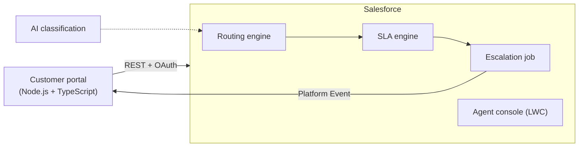

# Service Hub

**An SLA-driven customer service platform on Salesforce, built with the practices of a software engineering team.**

[Leia em português](README.pt-BR.md)

Customers open cases through an external portal. Cases land in Salesforce, are routed to the right queue, are measured against an SLA, and are escalated automatically before the deadline is missed.

The goal is to show production-grade Salesforce engineering, not just configuration: a layered Apex architecture, real tests, CI/CD with scratch orgs, an external integration and documented architecture decisions.

> Project name is provisional.

## How it works



1. **Routing:** a new case is sent to a queue by rules stored in Custom Metadata (`Routing_Rule__mdt`).
2. **SLA:** each case gets two deadlines, first response and resolution, computed with Business Hours from the account tier and case priority (`SLA_Policy__mdt`). The clock pauses while the case is _Waiting on Customer_.
3. **Escalation:** a scheduled job flags milestones at risk (level 1) and breached (level 2), records an audit trail and notifies the portal.

## Roadmap

| Phase              | Scope                                                                                      | Status  |
| ------------------ | ------------------------------------------------------------------------------------------ | ------- |
| 1. Foundation      | SFDX project, conventions, data model, ADRs                                                | Done    |
| 2. Domain          | Data model metadata, trigger framework, routing, SLA and escalation engines, 90%+ coverage | Done    |
| 3. Interface       | Agent console in LWC with Jest tests                                                       | Next    |
| 4. Integration     | Node.js + TypeScript portal, OAuth, Named Credentials, Platform Events                     | Planned |
| 5. DevOps          | GitHub Actions with scratch orgs, static analysis, coverage badges                         | Planned |
| 6. AI and showcase | AI case classification, final docs, demo video                                             | Planned |

## Documentation

- [Data model](docs/data-model.md): objects, fields, configuration and SLA targets
- [Architecture Decision Records](docs/adr/README.md): why each design choice was made
- [Contributing](CONTRIBUTING.md): branches, commit convention and pull requests

## Getting started

**Prerequisites:** [Salesforce CLI](https://developer.salesforce.com/tools/salesforcecli), Node.js 20+, a Dev Hub org, and VS Code with the Salesforce Extension Pack.

```bash
# 1. Install dev tooling (Prettier, ESLint, Jest)
npm install

# 2. Authenticate to your Dev Hub (once)
sf org login web --set-default-dev-hub --alias devhub

# 3. Create a scratch org and deploy
sf org create scratch --definition-file config/project-scratch-def.json --alias service-hub --duration-days 30 --set-default
sf project deploy start

# 4. Grant access, schedule the escalation job and open the org
sf org assign permset --name Service_Hub_Agent
sf apex run --file scripts/apex/schedule-escalation.apex
sf org open
```

## Project structure

```
force-app/main/default/
├── classes/             Apex: trigger framework, services, domain, selectors, tests
├── customMetadata/      SLA policies and routing rules (records)
├── objects/             Custom objects and fields on Account and Case
├── permissionsets/      Service_Hub_Agent
├── queues/              Support queues
├── settings/            Business Hours
├── standardValueSets/   Case Status, Priority and Origin values
└── triggers/            One trigger per object
scripts/apex/            One-off Apex scripts (job scheduling)
config/                  Scratch org definition
docs/                    Data model and ADRs
```

## Tech stack

Salesforce Platform (Apex, LWC, Custom Metadata, Platform Events) · Salesforce CLI · Node.js + TypeScript · Jest · ESLint · Prettier · GitHub Actions
