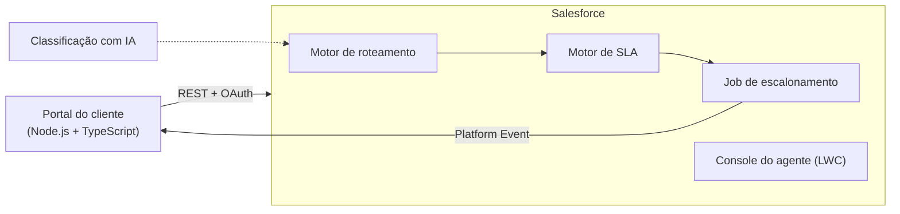

# Service Hub

**Uma plataforma de atendimento orientada a SLA no Salesforce, construída com as práticas de um time de engenharia de software.**

[Read in English](README.md)

Clientes abrem chamados por um portal externo. Os chamados chegam ao Salesforce, são roteados para a fila certa, medidos contra um SLA e escalonados automaticamente antes que o prazo estoure.

O objetivo é mostrar engenharia Salesforce de nível profissional, e não só configuração: arquitetura Apex em camadas, testes de verdade, CI/CD com scratch orgs, integração externa e decisões de arquitetura documentadas.

> O nome do projeto é provisório.

## Como funciona



1. **Roteamento:** um chamado novo vai para uma fila de acordo com regras guardadas em Custom Metadata (`Routing_Rule__mdt`).
2. **SLA:** cada chamado ganha dois prazos, primeira resposta e resolução, calculados com Business Hours a partir do tier da conta e da prioridade (`SLA_Policy__mdt`). O relógio pausa enquanto o chamado está em _Waiting on Customer_.
3. **Escalonamento:** um job agendado marca prazos em risco (nível 1) e estourados (nível 2), registra uma trilha de auditoria e avisa o portal.

## Roadmap

| Fase            | Escopo                                                                                                    | Status       |
| --------------- | --------------------------------------------------------------------------------------------------------- | ------------ |
| 1. Fundação     | Projeto SFDX, convenções, modelo de dados, ADRs                                                           | Concluída    |
| 2. Domínio      | Metadata do modelo, trigger framework, motores de roteamento, SLA e escalonamento, cobertura acima de 90% | Em andamento |
| 3. Interface    | Console do agente em LWC com testes Jest                                                                  | Planejada    |
| 4. Integração   | Portal em Node.js + TypeScript, OAuth, Named Credentials, Platform Events                                 | Planejada    |
| 5. DevOps       | GitHub Actions com scratch orgs, análise estática, badges de cobertura                                    | Planejada    |
| 6. IA e vitrine | Classificação de chamados com IA, documentação final, vídeo-demo                                          | Planejada    |

## Documentação

- [Modelo de dados](docs/data-model.md): objetos, campos, configuração e metas de SLA (em inglês)
- [Architecture Decision Records](docs/adr/README.md): por que cada decisão foi tomada (em inglês)
- [Como contribuir](CONTRIBUTING.md): branches, padrão de commits e pull requests (em inglês)

## Como rodar

**Pré-requisitos:** [Salesforce CLI](https://developer.salesforce.com/tools/salesforcecli), Node.js 20+, uma org com Dev Hub ativo e VS Code com o Salesforce Extension Pack.

```bash
# 1. Instalar as ferramentas de desenvolvimento (Prettier, ESLint, Jest)
npm install

# 2. Autenticar no Dev Hub (uma vez só)
sf org login web --set-default-dev-hub --alias devhub

# 3. Criar a scratch org e fazer o deploy
sf org create scratch --definition-file config/project-scratch-def.json --alias service-hub --duration-days 30 --set-default
sf project deploy start

# 4. Dar acesso e abrir a org
sf org assign permset --name Service_Hub_Agent
sf org open
```

## Estrutura do projeto

```
force-app/main/default/
├── classes/             Apex: trigger framework, serviços, domínio, selectors, testes
├── customMetadata/      Políticas de SLA e regras de roteamento (registros)
├── objects/             Objetos customizados e campos em Account e Case
├── permissionsets/      Service_Hub_Agent
├── queues/              Filas de atendimento
├── settings/            Business Hours
├── standardValueSets/   Valores de Status, Priority e Origin do Case
└── triggers/            Um trigger por objeto
config/                  Definição da scratch org
docs/                    Modelo de dados e ADRs
```

## Tecnologias

Salesforce Platform (Apex, LWC, Custom Metadata, Platform Events) · Salesforce CLI · Node.js + TypeScript · Jest · ESLint · Prettier · GitHub Actions
