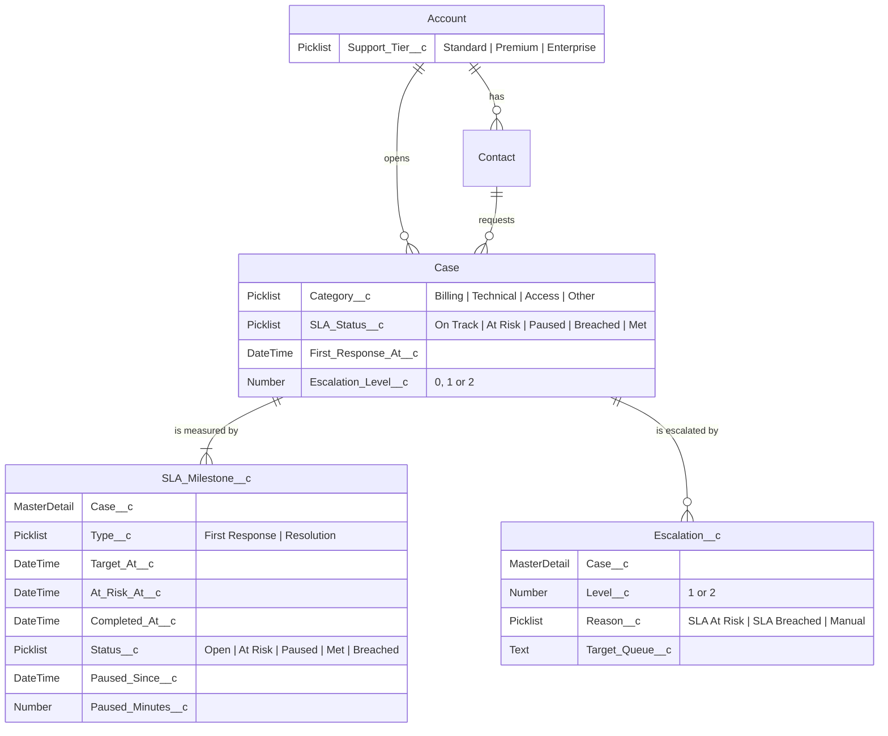

# Data model

The standard `Case` is the center of the model. Two custom child objects hold deadlines and escalation history, and every rule an admin would tune lives in Custom Metadata, outside the code.

## Standard objects

| Object  | Change                                                                                                                                               |
| ------- | ---------------------------------------------------------------------------------------------------------------------------------------------------- |
| Account | New field `Support_Tier__c` (Standard, Premium, Enterprise). Decides which SLA applies.                                                              |
| Contact | Used as is.                                                                                                                                          |
| Case    | Status: New, In Progress, Waiting on Customer, Escalated, Closed. Priority adds Critical. Origin: Portal, Email, Phone, API. New fields shown above. |

`SLA_Status__c`, `First_Response_At__c` and `Escalation_Level__c` are maintained by the SLA engine and are read-only for agents.

## Custom objects

| Object             | Purpose                                                                                                                         | Relationship          |
| ------------------ | ------------------------------------------------------------------------------------------------------------------------------- | --------------------- |
| `SLA_Milestone__c` | One record per deadline (first response, resolution). Allows history, reporting and new deadline types without changing `Case`. | Master-detail to Case |
| `Escalation__c`    | Audit trail: one record per escalation, never overwritten.                                                                      | Master-detail to Case |

## Configuration (Custom Metadata)

### `SLA_Policy__mdt`

One record per tier and priority. Targets are in business minutes; a milestone becomes **at risk** at 75% of its target. Enterprise accounts use the `Enterprise 24x7` Business Hours; the others use `Default` (Mon to Fri, 9:00 to 18:00, America/Sao_Paulo).

| Tier       | Priority | First response (min) | Resolution (min) |
| ---------- | -------- | -------------------- | ---------------- |
| Enterprise | Critical | 30                   | 240              |
| Enterprise | High     | 60                   | 480              |
| Enterprise | Medium   | 120                  | 960              |
| Enterprise | Low      | 240                  | 1,920            |
| Premium    | Critical | 60                   | 480              |
| Premium    | High     | 120                  | 960              |
| Premium    | Medium   | 240                  | 1,920            |
| Premium    | Low      | 360                  | 2,880            |
| Standard   | Critical | 120                  | 960              |
| Standard   | High     | 240                  | 1,920            |
| Standard   | Medium   | 360                  | 2,880            |
| Standard   | Low      | 480                  | 4,800            |

### `Routing_Rule__mdt`

Rules are evaluated by `Sort_Order__c`; the first match wins. An empty tier matches any tier. Cases that match no rule go to `General_Support`.

| Order | Category  | Tier | Queue               |
| ----- | --------- | ---- | ------------------- |
| 10    | Billing   | any  | `Billing_Support`   |
| 20    | Technical | any  | `Technical_Support` |
| 30    | Access    | any  | `Access_Support`    |

## Queues

`Billing_Support`, `Technical_Support`, `Access_Support`, `General_Support` (fallback) and `Tier2_Escalations` (breached SLAs).

## Business rules

**Routing** (before insert): read `Routing_Rule__mdt` in order, assign the first matching queue, fall back to `General_Support`.

**SLA** (after insert and on relevant updates):

1. Find the `SLA_Policy__mdt` for the account tier and case priority.
2. Create the First Response and Resolution milestones, with deadlines computed by `BusinessHours.add()`.
3. When the case leaves New, close the first response milestone as Met or Breached.
4. When the case is Closed, close the resolution milestone the same way.
5. When the priority changes, recompute the open milestones.
6. While the case is Waiting on Customer, open milestones are Paused. On resume, the paused minutes are added and the deadlines recomputed.

**Escalation** (`SlaEscalationBatch`, scheduled every 15 minutes):

1. A running milestone past `At_Risk_At__c` becomes At Risk and the case goes to level 1. The owner is unchanged.
2. An open milestone past `Target_At__c` becomes Breached, the case goes to level 2 and moves to `Tier2_Escalations`.
3. Every escalation creates an `Escalation__c` record and, from Phase 4, publishes `Case_Escalated__e`.
4. The case `SLA_Status__c` always reflects the worst status among its milestones.
5. Each level is escalated once. Paused and completed milestones never escalate; a breach that is already history (for example, a late first response) shows in `SLA_Status__c` but does not move the case to Tier 2.

## Integration (Phase 4)

| Item                               | Purpose                                                                                                                   |
| ---------------------------------- | ------------------------------------------------------------------------------------------------------------------------- |
| `Case.External_Id__c`              | Unique External Id: the case id in the portal, used for idempotent creation                                               |
| `Escalation__c.Event_Published__c` | True when the `Case_Escalated__e` event was queued                                                                        |
| `Integration_Log__c`               | One record per API call: direction, endpoint, status code, correlation id, payload, error                                 |
| `Case_Escalated__e`                | Platform Event published after commit on every escalation: case id and number, external id, level, reason, correlation id |

The REST contract is in [`docs/api/portal-api.yaml`](api/portal-api.yaml).

## Coming in later phases

| Phase | Addition                                                 |
| ----- | -------------------------------------------------------- |
| 6     | `Case.AI_Suggested_Category__c`, `Case.AI_Confidence__c` |
